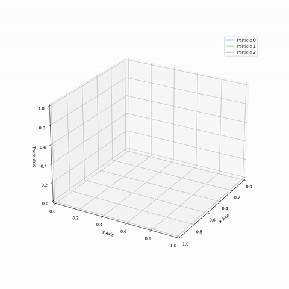
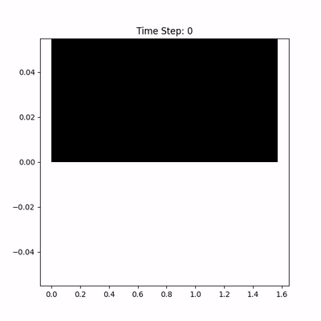
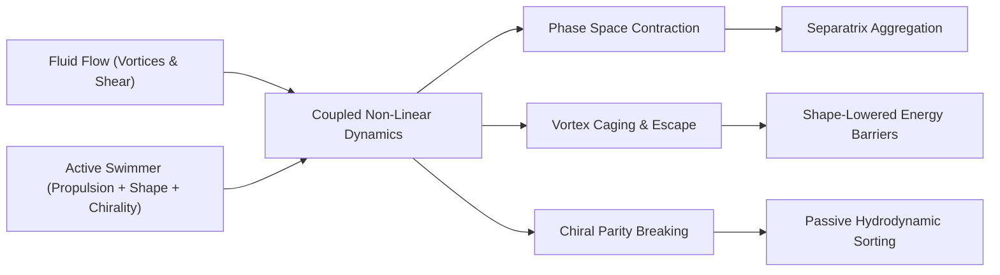
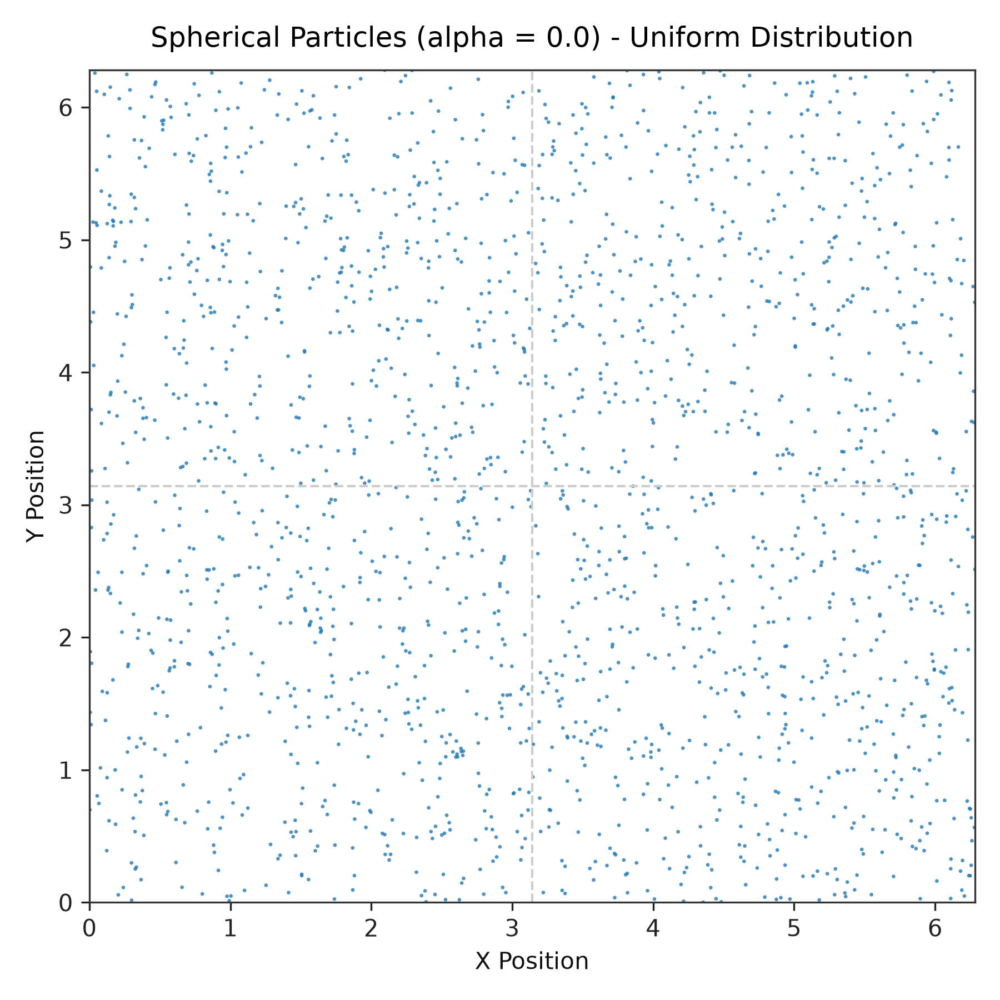
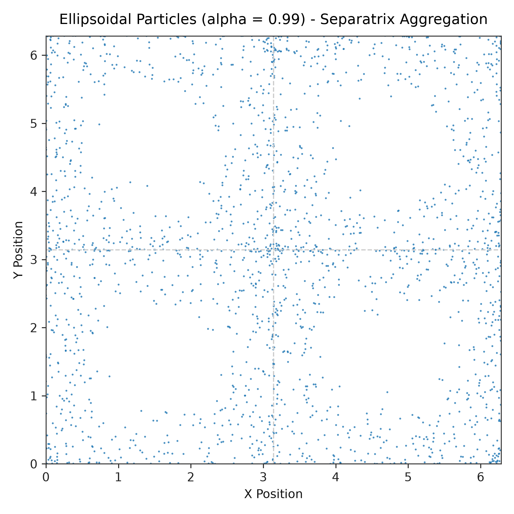
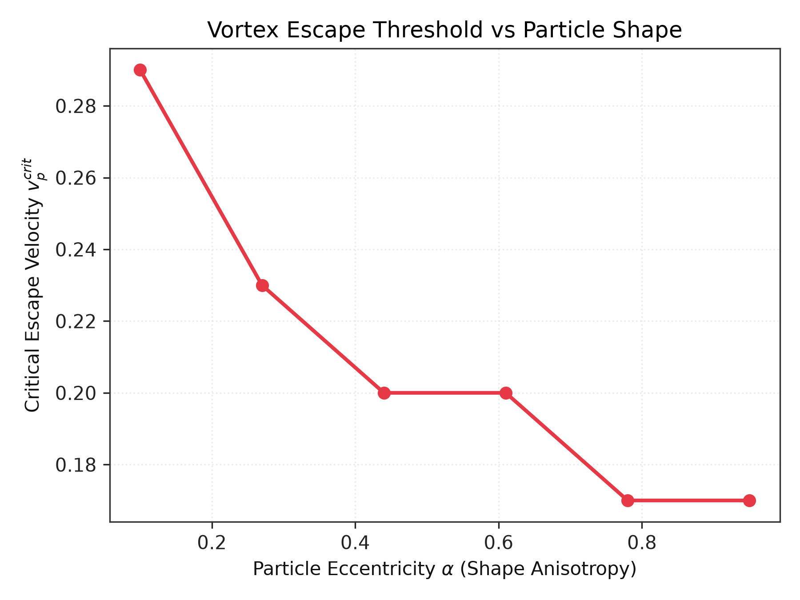
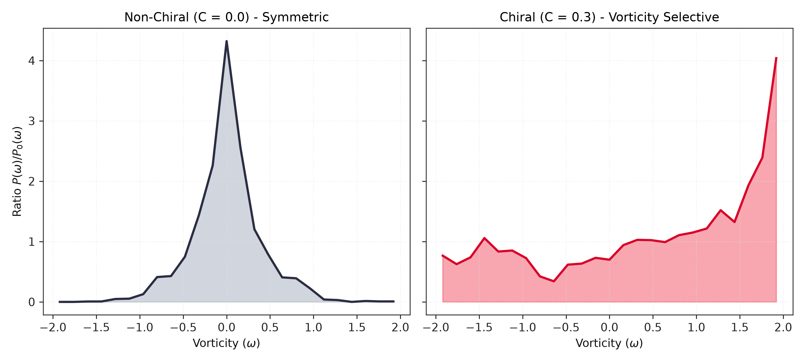
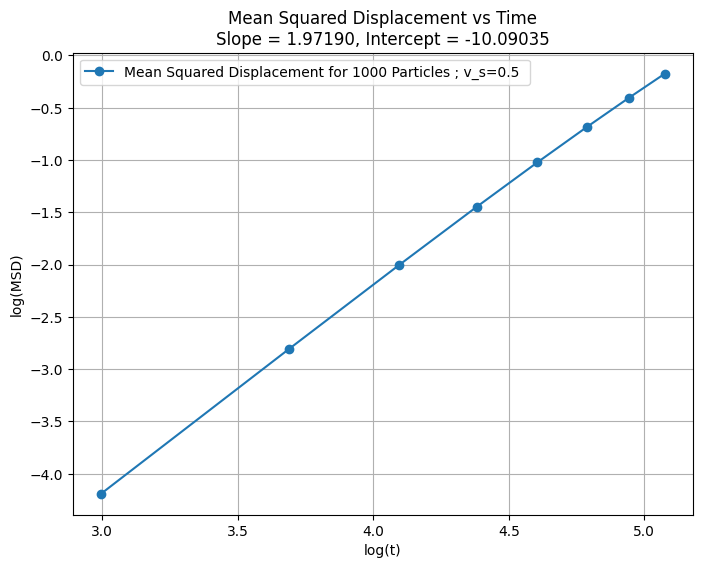
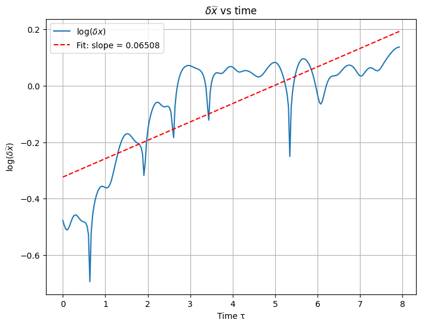

# Active Matter in Laminar Flow
### Modeling Microswimmer Transport, Separatrix Aggregation, and Chiral Sorting in Vortex Arrays

[](https://www.python.org/downloads/)
[](LICENSE)
[](https://iitpkd.ac.in/)

> **Master's Thesis Project** | Department of Physics, Indian Institute of Technology (IIT) Palakkad  
> **Author**: Semmugilan V (Roll No: 222305010)  
> **Advisor**: Dr. Akshay Bhatnagar  

---

<p align="center">
  
  &nbsp;&nbsp;
  
</p>
<p align="center">
  <em>Left: 3D phase space $(x, y, \theta)$ spiral trajectories of chiral microswimmers. Right: Spontaneous aggregation of elongated particles along flow separatrices.</em>
</p>

---

## 1. Why Active Matter? The Big Picture

If you drop a grain of dust into a cup of swirling water, it simply follows the flow. It drifts passively along streamlines, entirely at the mercy of the fluid.

Now drop a living bacterium—such as *Escherichia coli*—or a human sperm cell into that same swirling fluid. Something completely different happens. The bacterium consumes internal metabolic energy to propel itself forward. It steers, aligns with fluid shear, fights the local current, and either gets trapped inside an eddy or escapes into neighboring flow cells.

This is the essence of **Active Matter**: systems made of individual, self-driven agents that operate far from thermodynamic equilibrium. 

In nature, microswimmers navigate through complex, structured fluid environments:
* **In Medicine & Biology**: Bacteria colonize mucosal layers, sperm cells navigate reproductive tracts, and pathogens swim against convective bloodstream currents.
* **In Biotechnology**: Engineers are designing synthetic micro-robots and catalytic Janus particles for **targeted drug delivery**, aiming to transport therapeutic payloads directly to cancer tumors through microvascular networks.
* **In Microfluidics (Lab-on-a-Chip)**: How can we sort healthy cells from damaged cells, or separate bacterial species, **without filters, chemical tags, or mechanical centrifuges**?

To answer these questions, we must turn to **non-linear dynamics**.

---

## 2. Non-Linear Dynamics: The Superpower of Shape and Chirality

For decades, many models simplified microswimmers as tiny, spherical points. But in the real world:
1. **Bacteria are elongated rods** (*E. coli*, *Bacillus subtilis*).
2. **Swimming paths are curved (chiral)** due to flagellar torque or structural asymmetry.
3. **Biological flows are non-linear arrays of vortices and shear zones**.

When you combine self-propulsion with elongated geometry, linear approximations break down completely. Simple deterministic fluid flows give rise to rich non-linear phenomena: **phase space volume contraction**, **spontaneous boundary clustering**, **chaos**, and **vorticity-based sorting**.



---

## 3. Four Core Scientific Discoveries

### I. Shape Breaks Phase Space Conservation (Why Rods Cluster and Spheres Do Not)
A classic result in statistical mechanics—**Liouville’s Theorem**—states that Hamiltonian systems preserve volume in phase space. 

When a swimmer is a **perfect sphere** ($\alpha = 0$), the phase space divergence of the equations of motion is identically zero:
$$\nabla \cdot \mathbf{V} = \frac{\partial \dot{x}}{\partial x} + \frac{\partial \dot{y}}{\partial y} + \frac{\partial \dot{\theta}}{\partial \theta} = 0$$
Because phase space volume is strictly conserved, trajectories cannot converge onto attractors. If you start with a uniform cloud of spherical swimmers, they **remain uniformly distributed forever**.

However, real bacteria are elongated ellipsoids ($\alpha > 0$). Fluid velocity gradients exert a hydrodynamic torque governed by **Jeffrey's equation**. The phase space divergence becomes:
$$\nabla \cdot \mathbf{V} = -2\alpha \cos(x)\cos(y)\cos(2\theta) \neq 0$$
Phase space now locally expands and contracts! This compressibility allows trajectories to collapse onto low-dimensional attractors. Macroscopically, elongated microswimmers **spontaneously abandon the centers of vortices and aggregate into dense filaments along the separatrices**—the boundary lines separating opposing vortices.

| Spherical Swimmers ($\alpha = 0.0$) | Elongated Swimmers ($\alpha = 0.99$) |
| :---: | :---: |
|  |  |
| *Phase space volume conserved: particles remain evenly distributed.* | *Phase space contracts: particles aggregate along vortex separatrices.* |

---

### II. Elongation Lowers the Energy Cost of Vortex Escape
Microfluidic vortices act as hydrodynamic cages. A slow swimmer gets swept into a closed orbit inside a single vortex cell and cannot cross into neighboring cells.

To escape, a swimmer needs to reach a **critical propulsion speed** $v_p^{crit}$. 

Our simulations reveal that **elongation acts as an escape booster**:
* Nearly spherical particles ($\alpha \approx 0.1$) require a high propulsion speed ($v_p^{crit} \approx 0.29$) to break through the vortex barrier.
* As elongation increases ($\alpha \to 1.0$), the critical speed required to escape drops by **over 40%** ($v_p^{crit} \approx 0.17$).

Elongated bodies align with the local shear flow at cell boundaries, using the flow itself to slingshot across the separatrix. In evolutionary biology, this explains why so many motile bacteria have evolved rod-like morphology: **rod shapes allow organisms to disperse across fluid barriers with significantly lower energy expenditure**.

<p align="center">
  
</p>
<p align="center">
  <em>Figure: Critical propulsion velocity $v_p^{crit}$ needed to escape a vortex cell as a function of eccentricity $\alpha$. Elongated rods escape at substantially lower speeds.</em>
</p>

---

### III. Chirality Breaks Parity and Enables Passive Sorting
Many biological swimmers possess intrinsic handedness. For example, the counter-clockwise rotation of bacterial flagellar bundles or the asymmetric stroke of sperm tails creates a constant rotational torque: **chirality** ($C$).

In a flow with alternating clockwise and counter-clockwise vortices:
* When a swimmer's internal turning direction **matches** the vortex rotation (co-rotating), the particle locks into stable orbits and spends prolonged time in that vortex.
* When its turning direction **opposes** the vortex rotation (counter-rotating), the particle is rapidly destabilized and ejected.

By measuring the probability distribution of fluid vorticity sampled by particles, $P(\omega)$, and normalizing by the geometric baseline of a uniform sample, $P_0(\omega)$, we obtain the ratio $R(\omega) = P(\omega)/P_0(\omega)$:

<p align="center">
  
</p>
<p align="center">
  <em>Left: Non-chiral particles sample positive and negative vorticity symmetrically. Right: Chiral particles exhibit dramatic symmetry breaking, selectively concentrating in co-rotating vortices.</em>
</p>

> **Technological Application**: This mechanism enables **passive microfluidic sorters**. By running a cell suspension through a micro-vortex chip, cells with different chiralities or swimming speeds naturally separate into different fluid outlets without requiring filters, electric fields, or chemical reagents.

---

### IV. Time-Dependent Flows and Thermal Noise Melt Barriers
In steady flow ($B = 0$), rigid invariant manifolds (KAM-like boundaries) trap particles inside cells. When time-dependence is introduced through lateral flow oscillation:
$$\psi(x, y, t) = \frac{U_0 L}{2\pi} \sin\left(\frac{2\pi(x - B \sin \nu t)}{L}\right) \sin\left(\frac{2\pi y}{L}\right)$$
The separatrices oscillate and break into chaotic homoclinic tangles. Transport barriers dissolve, opening wide chaotic corridors that allow even sluggish swimmers to mix and traverse the entire domain.

Furthermore, microscopic swimmers constantly collide with thermal solvent molecules, introducing **rotational Brownian diffusion** ($D_r$). When the rotational noise rate exceeds the flow shear scale ($D_r \gtrsim U_0 / L$), deterministic alignment is disrupted, melting separatrix clusters back into uniform spatial distributions.

---

## 4. Mathematical Model & Numerical Method

### Governing Equations of Motion
The state of each swimmer is defined by its 2D position $\mathbf{r} = (x, y)$ and heading angle $\theta$:

$$\frac{dx}{dt} = v_x(x, y, t) + v_p \cos\theta$$

$$\frac{dy}{dt} = v_y(x, y, t) + v_p \sin\theta$$

$$\frac{d\theta}{dt} = \underbrace{U_0 \sin x \sin y}_{\text{Background Fluid Vorticity}} - \underbrace{\alpha \cos x \cos y \sin(2\theta)}_{\text{Jeffrey Shape-Shear Alignment}} + \underbrace{C}_{\text{Intrinsic Chirality}} + \underbrace{\sqrt{2 D_r} \, \eta(t)}_{\text{Rotational Brownian Noise}}$$

Where:
* $v_p$: Self-propulsion speed.
* $\alpha = \frac{\gamma^2 - 1}{\gamma^2 + 1}$: Eccentricity parameter ($\gamma = a/b$ is the major-to-minor axis ratio).
* $C$: Intrinsic chirality (angular velocity bias).
* $D_r$: Rotational diffusion coefficient ($\langle \eta(t)\eta(t') \rangle = \delta(t-t')$).

### Numerical Integrator
The equations are solved using a vectorized **2nd-Order Runge-Kutta (RK2 / Heun's method)** scheme implemented in NumPy. The engine simulates ensembles of **10,000 to 50,000 interacting agents** simultaneously across periodic boundary domains.

---

## 5. Statistical Mechanics & Chaos Metrics

| Diagnostic | Physical Meaning | Key Observation |
| :--- | :--- | :--- |
| **Mean Squared Displacement (MSD)** | $\langle \|\mathbf{r}(t) - \mathbf{r}(0)\|^2 \rangle \propto t^\beta$ | Early ballistic expansion ($\beta \approx 2$) transitions to confined saturation ($\beta \to 0$) in steady vortex cells. |
| **Lyapunov Exponent ($\lambda$)** | $\delta(t) = \delta(0) e^{\lambda t}$ | Trajectories separated by $\delta_0 = 10^{-5}$ diverge exponentially; higher swimming speed $v_p$ strengthens chaotic sensitivity. |
| **Vorticity Ratio $R(\omega)$** | $P(\omega) / P_0(\omega)$ | Quantitative measure of chirality-induced spatial preference in co-rotating vortex cores. |

<p align="center">
  
  &nbsp;&nbsp;
  
</p>

---

## 6. Repository Architecture

The project is structured as a modular, importable Python package with clean separation of concerns and standalone runnable examples:

```
active-matter-laminar-flow/
├── README.md                      # Documentation and scientific summary
├── requirements.txt               # Dependencies: numpy, scipy, matplotlib, tqdm
├── LICENSE                        # MIT License
│
├── src/active_matter/             # Core simulation library
│   ├── __init__.py                # Package exports
│   ├── flow.py                    # 2D cellular flow, streamfunctions, vorticity, strain tensor
│   ├── dynamics.py                # Jeffrey's equation, self-propulsion, chirality, noise
│   ├── integrator.py              # Vectorized RK2 engine for N-particle ensembles
│   ├── analysis.py                # MSD scaling, Lyapunov exponents, vorticity ratios
│   └── visualization.py           # Publication & 3B1B-style dark plotting utilities
│
├── examples/                      # Standalone, one-click runnable scripts
│   ├── simulate_trapping.py       # Spherical vs ellipsoidal aggregation comparison
│   ├── simulate_escape.py         # Critical escape speed vs particle eccentricity
│   ├── simulate_chirality.py      # Chiral trajectory winding & vorticity sorting ratio
│   ├── simulate_msd.py            # Mean Squared Displacement scaling & regimes
│   └── simulate_chaos.py          # Trajectory divergence & Lyapunov exponent calculation
│
├── notebooks/                     # Interactive exploratory Jupyter Notebooks
│   ├── 01_cellular_flow_and_trapping.ipynb
│   ├── 02_ellipsoidal_aggregation.ipynb
│   ├── 03_chirality_and_vorticity_sorting.ipynb
│   ├── 04_msd_and_chaos_analysis.ipynb
│   └── manim/                     # High-definition Manim animation scripts
│
├── assets/                        # Hero plots, figures, and lightweight GIFs
│   ├── figures/
│   └── animations/
│
├── reports/                       # Academic thesis reports and slides
│   ├── Major_Project_Report.pdf
│   ├── Major_Project_Presentation.pdf
│   └── Dynamics_of_Self_propelled_particles.pdf
│
└── references/                    # Foundational academic literature
```

---

## 7. Quickstart Guide

### 1. Installation
Clone the repository and install the lightweight requirements:
```bash
git clone https://github.com/mugiln/active-matter-laminar-flow.git
cd active-matter-laminar-flow
pip install -r requirements.txt
```

### 2. Run a Demonstration in 5 Seconds
Run any of the self-contained example scripts:
```bash
# Compare spherical vs ellipsoidal separatrix clustering
python examples/simulate_trapping.py

# Compute critical escape velocity vs particle shape
python examples/simulate_escape.py

# Run chiral vorticity sorting analysis
python examples/simulate_chirality.py

# Quantify chaotic divergence & Lyapunov exponents
python examples/simulate_chaos.py
```
Generated figures are automatically saved to `output/`.

### 3. Use as a Python Package
```python
import numpy as np
from active_matter import simulate_ensemble, plot_particles_2d

# 2000 elongated microswimmers (alpha = 0.99)
X0 = np.random.uniform(0.0, 2 * np.pi, size=(2000, 3))

# Evolve for 3000 timesteps under cellular flow
trajectories, times = simulate_ensemble(
    X0, dt=0.01, nt=3000, vp=0.05, alpha=0.99, wrap_pbc=True
)

# Render distribution
plot_particles_2d(trajectories[-1], title="Separatrix Aggregation")
```

---

## 8. Academic Thesis & References

This repository represents the master's thesis research carried out at **IIT Palakkad**:
* **Complete Report**: [`reports/Major_Project_Report.pdf`](reports/Major_Project_Report.pdf)
* **Presentation Slides**: [`reports/Major_Project_Presentation.pdf`](reports/Major_Project_Presentation.pdf)
* **Preliminary Study**: [`reports/Dynamics_of_Self_propelled_particles.pdf`](reports/Dynamics_of_Self_propelled_particles.pdf)

### Foundational Literature
1. **G. B. Jeffery**, *The Motion of Ellipsoidal Particles Immersed in a Viscous Fluid*, Proc. R. Soc. Lond. A **102**, 161–179 (1922).
2. **C. Torney and Z. Neufeld**, *Transport and Aggregation of Self-Propelled Particles in Fluid Flows*, Phys. Rev. Lett. **99**, 078101 (2007).
3. **C. Bechinger et al.**, *Active Particles in Complex and Crowded Environments*, Rev. Mod. Phys. **88**, 045006 (2016).
4. **T. J. Whitney and K. A. Mitchell**, *Ballistic to Diffusive Transition for Swimmers in a Periodic Vortex Array*, Phys. Rev. E **110**, 034203 (2024).

---

## License
This project is open-source under the [MIT License](LICENSE).
